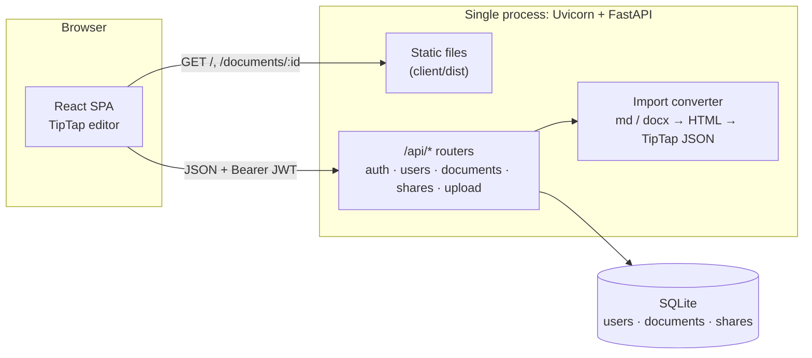
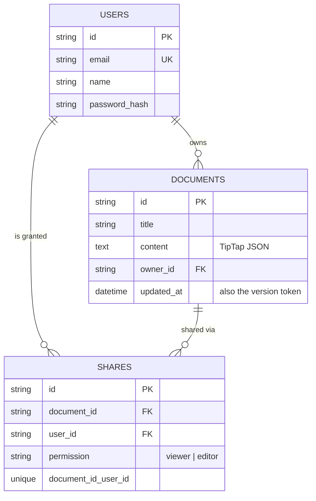

# Architecture Note

## What I prioritised, and why

The brief asks for the strongest *working* version within a timebox, so I ranked features by whether a reviewer could tell the product was broken without them.

| Priority | Scope | Reasoning |
|---|---|---|
| **P0: core loop** | Create, edit with rich text, rename, save, reopen; formatting survives a refresh | This is the product. If saving or formatting is unreliable, nothing else matters. |
| **P0: sharing that's visibly correct** | Owner / editor / viewer enforced on **every** API route; "My documents" vs "Shared with me"; read-only UI for viewers | Access control that's only enforced in the UI is a bug, not a feature. Every check lives on the server. |
| **P1: import that keeps formatting** | `.txt` / `.md` / `.docx` → new document | An import that drops headings and lists makes a rich-text editor look broken, so fidelity mattered more than the number of formats. |
| **P1: trustworthy saving** | Debounced auto-save, single in-flight request, retry, unsaved-changes warning, **conflict detection** | Silent data loss is the worst failure a docs product can have. |
| **P2: quality** | Validation with clear 4xx messages, 74 automated tests, typed API layer, responsive layout, accessible controls | Shows how I'd work on a real team. |
| **P3: deployment** | One Docker image and a Render blueprint | One URL and one process are the least that can go wrong for a reviewer. |

**Deliberately not built:**

- **Real-time co-editing** (CRDT/OT with WebSockets). It's the biggest piece of a real Google Docs and would have taken most of the timebox. Optimistic conflict detection is the honest smaller version: it prevents lost work without pretending to merge.
- Comments, version history, sign-up and password reset, images and tables in the editor.

---

## System overview

- **One deployable.** FastAPI serves the built React app and the API from the same origin: no CORS in production, one URL, one health check. In development, Vite's proxy keeps the same `/api` path.
- **Backend layering.** Each feature module has `router` (HTTP and permission checks), `schemas` (Pydantic validation) and `service` (DB operations). Dependencies (`get_db`, `get_current_user`) are injected with `Depends`, so tests swap in an in-memory database.
- **Frontend layering.** `pages → components → hooks → api`. The API layer is typed against the backend schemas, and pages never call Axios directly.

## Data model

The owner is a column, not a share row. "Who can do what" is resolved in one place (`_resolve_role` → `owner | editor | viewer | none`), and `UNIQUE(document_id, user_id)` prevents duplicate grants at the database level.

---

## Key decisions and trade-offs

**Store TipTap JSON, not HTML.** The editor's native format round-trips losslessly, so formatting can't drift between saves. It's stored as `TEXT` and validated on every write (must parse and must be `{"type": "doc"}`, max 2 MB), so a bad client can't store something the editor can't open.

**Import through HTML into a known-safe subset.** `.md` (python-markdown) and `.docx` (mammoth) both convert to HTML, and one mapper turns HTML into TipTap nodes. The mapper only emits node and mark types the editor schema has. Anything else, like links, images and tables, is reduced to its text. ProseMirror throws on unknown node types, so a "richer" import that the editor can't load would be worse than a plain one. The UI states what's kept and what isn't.

**Don't keep raw uploads.** The product flow is "import a file as a new document", so the converted document is the source of truth. Storing originals would only add storage to secure and clean up. An earlier version saved them under a public `/uploads` route, which I removed.

**Optimistic concurrency instead of real-time sync.** Every save sends the `updated_at` it was based on. If the document changed since then, the server returns **409** and the client stops auto-saving and offers *Load latest* or *Keep mine*. Without this, the second of two editors silently erases the first. It's a few lines of code and needs no WebSocket infrastructure. The next step would be Yjs (a CRDT) over WebSockets with presence. TipTap has first-class support, and the JSON storage stays the same.

**Auto-save details matter.** Edits are merged into one pending payload and debounced (1.5 s). Only one request is in flight at a time, and edits made during a save go into the next one. A failed save keeps its changes for *Retry*. The browser warns before closing a tab with unsaved work. All of this is unit-tested with fake timers.

**Auth is deliberately small.** Seeded users, bcrypt hashes and a 24 h HS256 JWT sent as a Bearer header. That's enough to demonstrate multi-user sharing honestly: every request is authenticated and every document check is server-side. Known trade-off: the token lives in `localStorage`, which an XSS bug could read. In production I'd use SSO with an httpOnly, SameSite session cookie.

**SQLite now, Postgres-ready.** There's nothing for a reviewer to set up. SQLAlchemy keeps the swap to a `DATABASE_URL` change. Tables are created at startup, and Alembic is configured for the first real schema migration. Render's free disk is ephemeral, so demo data re-seeds on restart, which is acceptable for a demo and documented.

**Timestamps are always UTC with an offset.** SQLite drops timezone info, so the API re-attaches UTC before serialising. Otherwise browsers read the times as local, and "edited 2m ago" is off by hours.

## Validation and error handling

- **Pydantic at the edge.** Titles are trimmed and limited to 1–255 characters, content must be valid editor JSON, permission must be `viewer` or `editor`, and empty updates are rejected. These return 422 with a readable message.
- **Uploads.** Extension allow-list, 5 MB streaming cap (413), empty or binary-as-text files (400), corrupt `.docx` (400), and path components stripped from filenames.
- **Status codes.** Missing or invalid token → 401, and the client sends you back to sign-in. Authenticated but not allowed → 403. Unknown document → 404. Stale save → 409. Any unexpected exception → a JSON 500 with a generic message, with details logged on the server.
- **Frontend.** One `getErrorMessage()` turns any API error into a sentence. Errors appear inline next to the action that failed, never as a blank screen.

## Testing strategy

- **Backend (pytest, 60).**
  - API tests through FastAPI's `TestClient` against an in-memory SQLite database, so they exercise routing, validation, auth and permissions together.
  - Unit tests for the converter, including "never emit an empty text node", a ProseMirror invariant.
- **Frontend (Vitest + Testing Library, 14).** Behaviour-level tests:
  - dashboard tabs, create and import flows
  - client-side file rejection
  - the auto-save hook's debounce, version chaining, conflict and retry paths
- **End to end (manual script, not in CI).** Playwright drives three users through the deployed build: create and format, refresh, share, import `.md` and `.docx`, view-only access, a concurrent-edit conflict, permission downgrade, a phone-sized viewport and delete.

## What I'd do next

1. Real-time collaboration: Yjs over WebSockets (Hocuspocus), presence cursors, then drop the 409 path.
2. Postgres plus Alembic migrations in CI; move the JWT to httpOnly cookies or SSO.
3. Images (object storage with signed URLs), tables and links in the editor schema, so import fidelity can go up too.
4. Version history (snapshot on save) and comments.
5. Playwright suite in CI against the Docker image.
